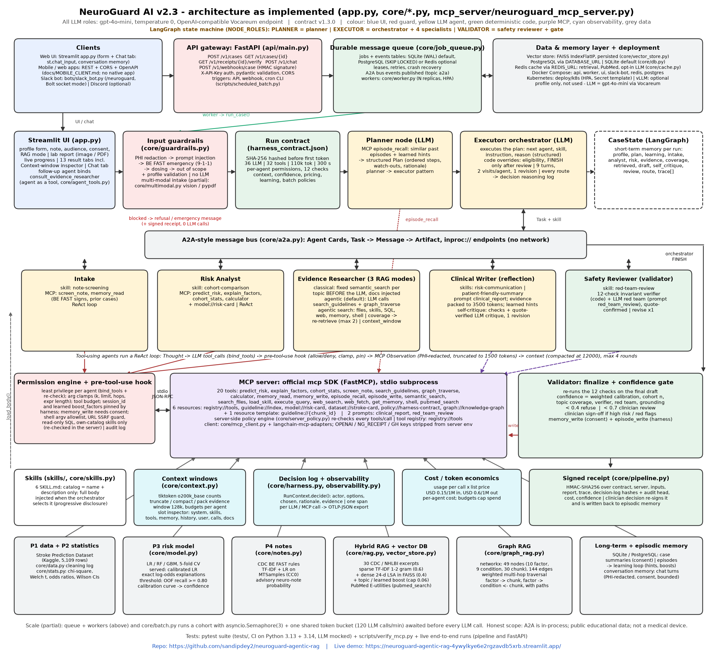

# 🧠 NeuroGuard AI — governed multi-agent stroke-risk decision support

**Live demo:** _add the Streamlit Cloud URL after deployment_ · **Paper:** [module_summary.pdf](module_summary.pdf) · **Evaluation:** [evaluation.ipynb](evaluation.ipynb) · **License:** MIT (code)

> ⚠️ **Decision support only — not a medical device.** No regulatory clearance. Not for diagnosis, treatment or emergency triage.
> If someone shows sudden face drooping, arm weakness or speech difficulty, call 9-1-1.

NeuroGuard AI turns a patient profile (plus an optional free-text note) into a **cited, verified stroke-risk report**.
An LLM orchestrator (gpt-4o-mini via the OpenAI-compatible Vocareum endpoint, temperature 0) delegates to five
specialist agents that act only through a **real MCP server** (official `mcp` SDK, stdio subprocess). A deterministic
verifier and an LLM red-team pass check every draft, a finalize gate refuses anything that fails, and every run
ends with an **HMAC-SHA256 signed receipt**. Udacity AI Mastery Capstone — Project 7 (Integrative Industry Synthesis), healthcare.



## How a request flows (as implemented)
1. **Input guardrails** (`core/guardrails.py`, no LLM): PHI redaction → prompt-injection/tool-misuse block → CDC BE FAST emergency stop ("call 9-1-1") → medication-dosing refusal → out-of-scope refusal.
2. **Run contract** (`harness_contract.json`) is loaded and SHA-256 hashed before the first token: 9 turns, 30 LLM calls, 24 tool calls, 80k tokens, 240 s, per-agent permissions, 12 required checks.
3. **Orchestrator** (`core/agents.py`, LangGraph): LLM picks next agent + skill + instruction; code enforces eligibility, FINISH-only-after-review, one revision, visit/turn caps. Every override is logged.
4. **Specialists** — Intake, Risk Analyst, Evidence Researcher, Clinical Writer, Safety Reviewer — exchange **A2A-style** tasks/messages/artifacts (`core/a2a.py`). Tool users run the harness loop: context → LLM → tool call → **pre-tool-use hook** → MCP result (PHI-redacted) → back to context.
5. **Finalize gate** re-runs the verifier; high-risk or red-flag cases need **clinician sign-off** in the UI; consented de-identified summaries go to SQLite memory via `memory_write`; a signed receipt is produced.

## Coverage of the nine required concepts
| # | Concept | Where / how (real code) |
|---|---|---|
| 1 | Harness: agent loop, fixed contract, gate | `react()` loop in `core/agents.py`; `harness_contract.json` hashed in `core/harness.py`; `gate` node refuses to finalize unless all 12 checks pass |
| 2 | Memory & state | Short-term: LangGraph `CaseState`. Long-term: SQLite (`core/memory.py`) via MCP `memory_read`/`memory_write`, consent checkbox + clear button |
| 3 | RAG | `core/rag.py` TF-IDF over 30 verbatim CDC/NHLBI excerpts → injected via `guideline://{id}` resources → writer cites `[G-xx]`; verifier checks citations were retrieved |
| 4 | MCP | `mcp_server/neuroguard_mcp_server.py`: 8 tools, 4 resources + 1 resource template, 2 prompts; `scripts/verify_mcp.py` |
| 5 | Skills | `skills/*/SKILL.md`; `core/skills.py` exposes name+description only; body injected when selected (trace: `skill_loaded`) |
| 6 | Guardrails & permissions | Input guardrails; permission engine + pre-tool-use hook (`core/permissions.py`); AST-sandboxed calculator; consent for writes; human approval; hash-chained audit log |
| 7 | Evals | Executed `evaluation.ipynb`, `eval/cases.json`, `eval/summary.json`, `eval/raw_results.json` (traces) |
| 8 | A2A | Agent Cards + Task/Message/Artifact on an **in-process** bus modelled on the A2A spec (not a networked A2A server) |
| 9 | Multi-agent system | LLM orchestrator + 5 specialists with a genuine graph cycle and caps |
| + | Verifier, red team, receipt | Deterministic invariants + quote-confirmed LLM red team; HMAC-SHA256 `receipt.json` (download in UI) |

## Integration of prior capstones
| Project | Reused concept | In NeuroGuard |
|---|---|---|
| P1 [ai-programming-foundations](https://github.com/sandipdey2/ai-programming-foundations-project) | logged cleaning workflow | `core/data.py` pipeline log, train-only imputation |
| P2 [statistical-analysis](https://github.com/sandipdey2/statistical-analysis-project) | hypothesis tests | chi-square, Welch t, odds ratios, Wilson CIs → `cohort_stats` tool |
| P3 [breast-cancer-classification](https://github.com/sandipdey2/breast-cancer-classification) | logistic regression | LR vs RF vs GBM, class weights, calibration, exact explanations |
| P4 [imdb-sentiment-rnn](https://github.com/sandipdey2/imdb-sentiment-rnn) | text/sequence modelling | TF-IDF+LR note classifier (MTSamples) + BE FAST rules; lightweight instead of LSTM for Cloud CPU |
| P5 [generative-mnist](https://github.com/sandipdey2/generative-mnist) | generative modelling | Clinical Writer generates the report from an MCP prompt |
| P6 [agentic-rag-system](https://github.com/sandipdey2/agentic-rag-system) | agentic RAG | multi-agent + **real** MCP + verifier; fixes the earlier MCP/loop overclaiming |

## Evaluation results (from the executed notebook, `eval/summary.json`)
| Metric | Result |
|---|---|
| Risk model held-out ROC-AUC / PR-AUC / Brier (1,022 patients, 50 strokes) | 0.84 / 0.26 / 0.041 |
| Recall / precision at recall-oriented threshold | 0.8 / 0.137 |
| CV ROC-AUC: logistic / random forest / gradient boosting | 0.838 / 0.835 / 0.822 |
| Note classifier test F1 (advisory) | 0.31 |
| Retrieval hit@3 / MRR (12 labelled queries) | 1.0 / 1.0 |
| Attacks blocked (8) / normal requests wrongly blocked (8) | 1.0 / 0.0 |
| Policy-valid routes / LLM route choices accepted | 1.0 / 0.82 |
| Reports finalized / first-draft pass | 1.0 / 0.875 |
| Citation coverage / LLM-judged faithfulness / word-overlap support | 1.0 / 1.0 / 0.612 |
| Mean latency / LLM calls / MCP tool calls | 56.3 s / 17.6 / 8.4 |
| Receipts verify / tampered receipt verifies / audit chains valid | yes / no / yes |

**Documented failure:** an earlier full run finalized only 3/8 reports — the provider's content filter (`finish_reason="content_filter"`) truncated drafts that pasted the CDC BE FAST passage verbatim, and the gate correctly refused them. Fixed by short paraphrased findings and one retry on truncation; a notebook probe did not reproduce it in the final run (0 of 3 isolated prompts filtered), so it is reported as a development observation. See the paper for other limitations.

## Run locally
```bash
git clone https://github.com/sandipdey2/neuroguard-agentic-rag && cd neuroguard-agentic-rag
python -m venv .venv && source .venv/bin/activate && pip install -r requirements.txt   # Python 3.13 or 3.14
cp .streamlit/secrets.toml.example .streamlit/secrets.toml   # add OPENAI_API_KEY (+ OPENAI_API_BASE)
python scripts/verify_mcp.py          # MCP over stdio: tools/resources/prompts list + calls
python scripts/smoke_test.py          # one full multi-agent run
streamlit run app.py
```
Tests: `python scripts/apptest_session.py` (Streamlit AppTest, several consecutive cases + attacks in one session). Rebuild: `scripts/draw_architecture.py`, `scripts/build_pdf.py`, `scripts/build_dist.py` (product zip), `scripts/fetch_data.py` (re-download + checksum data).

## Deploy on Streamlit Community Cloud
New app → repo `sandipdey2/neuroguard-agentic-rag`, branch `main`, file `app.py` → Advanced settings → Secrets:
```toml
OPENAI_API_KEY = "your key"
OPENAI_API_BASE = "https://openai.vocareum.com/v1"
NG_RECEIPT_KEY = "a long random string"
```

## Data (public only — see DATA_SOURCES.md)
Stroke Prediction Dataset (fedesoriano, Kaggle; educational use — excluded from the product zip), MTSamples (CC0), 30 verbatim CDC/NHLBI excerpts (U.S. public domain).

## Limitations & ethics
Educational dataset with no race/ethnicity field and no event timing; estimates are associations, not incidence. Guardrails are regex-based; 16 eval cases are too few for confidence intervals; retrieval labels are author-made; runs take ~1 minute; Streamlit Cloud storage is ephemeral and not HIPAA-compliant; A2A is in-process. The LLM red team was noisy during development, so its findings are quote-confirmed by code.

## Product
Gumroad listing draft: [docs/GUMROAD_LISTING.md](docs/GUMROAD_LISTING.md) · buyer guide: [docs/BUYER_SETUP.md](docs/BUYER_SETUP.md) · [CHANGELOG.md](CHANGELOG.md)
