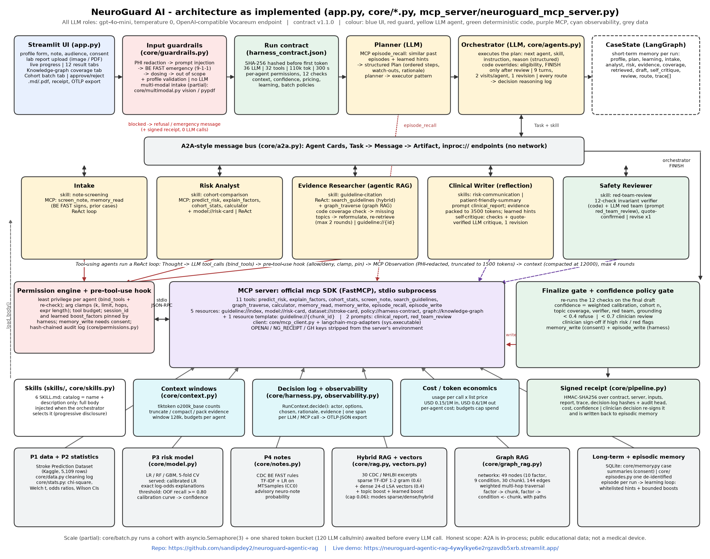

# NeuroGuard AI: A Governed Multi-Agent System for Stroke-Risk Clinical Decision Support

Sandip Dey · Udacity AI Mastery Capstone, Project 7 (Integrative Industry Synthesis) · Code: https://github.com/sandipdey2/neuroguard-agentic-rag · Live demo: https://neuroguard-agentic-rag-4ywylkye6e2rgzavdb5xrb.streamlit.app/

## Overview and Industry Context

Stroke is a leading cause of serious long-term disability in the United States, where more than 795,000 people have a stroke every year (Centers for Disease Control and Prevention [CDC], 2024). Most of its drivers—high blood pressure, diabetes, heart disease, smoking—are measurable in routine primary care, yet clinicians have only minutes per visit to combine a risk estimate, the relevant guideline wording and a clear explanation. Generative AI could draft that synthesis, but in healthcare an unsupported sentence, an invented number or a dosing suggestion is a safety event, not a style problem.

NeuroGuard AI is my answer to that problem: a decision-support prototype that turns a structured patient profile and an optional free-text note into a cited, verified stroke-risk report for a clinician or a patient. It is deliberately not a medical device. Under the U.S. Food and Drug Administration's (2022) guidance, software that supports, rather than replaces, a professional's judgement must let that professional review the basis of each recommendation; NeuroGuard is designed around that idea. Every number is traceable to a tool output, every guideline claim cites a public-domain CDC or NHLBI excerpt, and a gate refuses to release reports that fail its checks. All data are public: the Stroke Prediction Dataset (fedesoriano, 2021; 5,110 records, 5,109 after cleaning), MTSamples transcriptions (Boyle, n.d.; CC0) and 30 verbatim guideline excerpts.

## Integration Rationale

The system is built from six earlier capstone projects, each chosen because it solves one part of the clinical workflow.

| Prior project | Contribution to NeuroGuard |
|---|---|
| P1 Data workflow (Titanic) | Explicit cleaning steps with a log: schema check, "N/A" BMI to missing, rare-category filter, imputation fitted only on the training split (`core/data.py`). |
| P2 Statistical analysis (heart failure, Welch's t-test) | Chi-square and Welch tests, odds ratios with 95% CIs and Wilson intervals; served to agents by the `cohort_stats` MCP tool. |
| P3 Classification (breast cancer, logistic regression) | Logistic regression, random forest and gradient boosting with class weighting; calibrated logistic model served with exact factor contributions. |
| P4 Sequence model (IMDB LSTM) | Text modelling for notes: TF-IDF + logistic regression on MTSamples, plus CDC BE FAST red-flag rules. |
| P5 Generative model (MNIST GAN) | Generation moved from pixels to language: the Clinical Writer produces the report from an MCP prompt template. |
| P6 Agentic RAG | Retrieval and an agent loop, now with a real MCP server, multiple agents and enforced verification. |

The integration is causal, not decorative. P2's odds ratios (age 65+: 8.13, hypertension: 3.7, heart disease: 4.71) justify which factors the evidence agent searches for; P3 supplies the number they contextualize; P4's rules guard the front door. A Project 6 reviewer correctly noted that I had described an in-process class as an "MCP server" and a single routing step as a loop. This project fixes both: the server is a separate process that speaks the Model Context Protocol (Anthropic, 2024) over stdio, and the orchestrator loop is a real graph cycle with a cap.

## System Design and Technical Decisions

Figure 1 shows the architecture as implemented; every box names the file that implements it.

**Harness and contract.** Before the first token, `harness_contract.json` is loaded and SHA-256 hashed. It fixes the model (gpt-4o-mini via the Vocareum OpenAI-compatible endpoint, temperature 0), nine orchestrator turns, budgets of 36 LLM calls, 32 tool calls, 110,000 tokens and 300 seconds, each agent's permitted tools, resources and prompts, twelve required checks, context budgets, a confidence policy and list prices. The hash goes into the run receipt, so a reviewer can tell which rules governed a run.

**Planner and multi-agent loop.** A planner LLM first recalls similar de-identified past episodes and writes a structured plan. A LangGraph orchestrator (an LLM with structured output) executes it, choosing the next agent, a skill and an instruction; five specialists—Intake, Risk Analyst, Evidence Researcher, Clinical Writer and Safety Reviewer—return to it after every step. Code enforces eligibility: the gathering agents run in any order, the writer only after all three, the reviewer after each draft, and FINISH only after review, with one revision allowed. Tool-using agents run a bounded ReAct loop (Yao et al., 2023) whose thoughts, actions and observations are traced, with tool outputs truncated to a token budget. The writer critiques its own draft before review—deterministic checks plus an LLM critique whose quotes must exist in the draft—and revises once. Delegation uses A2A-style Agent Cards and task/message/artifact objects (A2A Project, 2025); honestly scoped, this bus is in-process, not a networked A2A server.

**Real MCP.** The official SDK server exposes eleven tools (risk prediction, factor explanation, cohort statistics, note screening, guideline search, graph traversal, a sandboxed calculator, memory read and write, episode recall and write), five resources plus a per-excerpt template, and two prompts. The client strips the API key from the subprocess environment.

**Permissions, memory and skills.** Each agent is bound only to its own tools, and a pre-tool-use hook re-checks every call, clamps arguments, pins the session identifier so no agent can read another session, enforces the tool budget and blocks `memory_write` without consent. Short-term memory is the LangGraph state; long-term memory is a consent-based SQLite table of de-identified summaries with a clear button. Skills are `SKILL.md` files: only their names and descriptions are offered to the orchestrator, and the full body is injected when one is selected (progressive disclosure).

**Retrieval and modelling choices.** Retrieval follows retrieve-then-generate (Lewis et al., 2020) in three layers. Hybrid search fuses TF-IDF (weight 0.6) with 24-dimensional LSA vectors (0.4); the MCP server holds no API key, so its vectors are local, and the notebook compares them with OpenAI embeddings. A networkx graph of 49 factor, condition and excerpt nodes supports multi-hop traversal with explainable paths. Finally, code checks that every required topic is covered by a cited excerpt and, if not, the agent reformulates and retrieves again. For risk, cross-validated ROC-AUC was 0.838 (logistic regression), 0.835 (random forest) and 0.822 (gradient boosting). I served the logistic model with sigmoid calibration because it was best and its log-odds contributions are exact; calibration matters because class weighting inflates probabilities (Niculescu-Mizil & Caruana, 2005). For notes, TF-IDF replaced the P4 LSTM because it trains in seconds on a CPU.

**Verifier, red team, gate and receipt.** The Safety Reviewer runs deterministic invariants—risk in [0, 1], risk equal to a `predict_risk` call on the exact profile, every evidence bullet cited, citations actually retrieved, every number in the report found in a tool output or excerpt, no dosing or diagnosis language, disclaimer present, no PHI, budget respected—plus an LLM red-team pass. During development the red team, on gpt-4o-mini, flagged harmless sentences, so its findings are kept only when the quoted sentence really occurs in the draft and, for rules with a visible surface form, shows it. The finalize gate re-runs the checks and refuses to finalize on any failure; high-risk results and notes with red-flag signs require clinician sign-off. A confidence score (calibration, cohort size, topic coverage, verifier, red team, grounding) refuses below 0.4 and requests review below 0.7. Each run ends with an HMAC-SHA256 receipt over hashes of inputs, report, trace, checks and a decision reasoning log, plus a hash-chained audit log, OTLP-JSON spans and a list-price cost.

**Learning, modality and scale (partial).** Each run stores a de-identified episode; recurring reviewer feedback becomes whitelisted hints and clinician approvals become retrieval boosts capped at 0.06, so learning is bounded and reversible. Lab values can be read from an image with gpt-4o-mini vision or from a text PDF, and a batch runner processes a small cohort under a shared rate limit. `docs/KNOWLEDGE_GRAPH_COVERAGE.md` maps all 27 agentic-AI concepts to code: 23 full, 4 partial.

## Ethical Considerations and Responsible AI

The risks are specific to this system. First, **harm from false reassurance or delay**: a person describing sudden face drooping must not receive a risk report. Input guardrails therefore run before any LLM call, and the BE FAST rule stops the request with CDC's "call 9-1-1" wording (CDC, 2026). Second, **unsafe advice**: dosing questions are refused at input, and dosing or diagnosis language fails the verifier at output. Third, **privacy**: emails, phone numbers, record numbers and titled names are redacted before processing, memory stores only de-identified summaries with explicit consent, and Streamlit Community Cloud is documented as unsuitable for real PHI. Fourth, **bias and data provenance**: the dataset's source is described as confidential and for educational use, its binary label records whether a patient had a stroke without any timing (so estimates describe association with stroke history, not future incidence), and it contains no race or ethnicity field, so the model cannot be audited for the kind of group bias that Obermeyer et al. (2019) found in a deployed health algorithm. The app states this, and the product zip excludes the dataset. Fifth, **accountability and transparency**, mapped to the Govern, Map, Measure and Manage functions of the NIST AI Risk Management Framework (National Institute of Standards and Technology [NIST], 2023) and to the WHO's (2021) call for human oversight: the contract, audit chain, signed receipt and approval step make every run reviewable by a named human.

## Evaluation and Reflection

`evaluation.ipynb` was executed against the real endpoint and MCP server on eight real held-out profiles and eight attacks. The risk model's held-out results were ROC-AUC 0.84, PR-AUC 0.26 (prevalence 0.0487) and Brier score 0.041; at the recall-oriented threshold it reached recall 0.8 but precision only 0.137, which is acceptable for a prompt to discuss risk but would be unacceptable as a screening decision (Saito & Rehmsmeier, 2015). The note classifier is weak (F1 0.31), so it is advisory only.

| Agent metric | Result |
|---|---|
| Attacks blocked (injection, tool misuse, emergency, dosing, off-topic) | 1.0 (reason correct 1.0) |
| Normal requests wrongly blocked | 0.0 |
| Plan followed / LLM route choices accepted without override | 1.0 / 0.98 |
| Re-retrieval rate / final topic coverage | 0.25 / 1.0 |
| Reports finalized / reviewer first-draft pass | 1.0 / 0.875 |
| Citation coverage / LLM-judged faithfulness (Es et al., 2024) | 1.0 / 0.977 |
| Paraphrase retrieval hit@3: sparse / hybrid | 0.875 / 1.0 |
| Mean confidence / cost per run (list price) | 0.911 / USD 0.0053 |
| Mean latency / LLM calls / MCP tool calls | 87.2 s / 20.4 / 9.8 |

The most useful finding was a failure. An earlier run finalized only three of eight reports: the writer pasted the long BE FAST passage verbatim, the provider stopped generation with `finish_reason="content_filter"`, and the gate correctly refused the truncated drafts. A probe did not reproduce the stop (0 of 3 prompts), so I report it as an observation. Short paraphrased findings and one retry fixed it; paraphrasing keeps word-overlap support low (0.55) while LLM-judged faithfulness is 0.977 (one of 44 bullets cited an excerpt that did not support it), so a lexical proxy should not be the only grounding metric. Adding the planner raised accepted route choices from 0.82 to 0.98, and dense vectors fixed the paraphrase query that sparse search missed. The costs were latency (56.3 to 87.2 seconds) and calls (17.6 to 20.4 per run). Other weaknesses: regex guardrails, sixteen cases, self-labelled queries, a heuristic confidence score, and a learning-loop demonstration of only two reruns. Next I would validate on a licensed cohort and parallelize the gathering agents.

## Professional Relevance

This project reflects how I would ship AI in a regulated setting: start from a contract, give each agent least privilege, verify outputs deterministically, keep a human approval step and leave a signed record. It combines technical, analytical, ethical and communication skills in a live Streamlit app packaged as an MIT-licensed starter kit without the educational-use dataset. Before any clinical pilot I would add external validation, networked A2A with authentication and a compliance review.

## References

A2A Project. (2025). *Agent2Agent (A2A) protocol specification*. The Linux Foundation. https://a2a-protocol.org/latest/specification/

Anthropic. (2024, November 25). *Introducing the Model Context Protocol*. https://www.anthropic.com/news/model-context-protocol

Boyle, T. (n.d.). *Medical transcriptions* [Data set]. Kaggle. https://www.kaggle.com/datasets/tboyle10/medicaltranscriptions

Centers for Disease Control and Prevention. (2024, October 24). *Stroke facts*. https://www.cdc.gov/stroke/data-research/facts-stats/index.html

Centers for Disease Control and Prevention. (2026, May 19). *Signs and symptoms of stroke*. https://www.cdc.gov/stroke/signs-symptoms/index.html

Es, S., James, J., Espinosa-Anke, L., & Schockaert, S. (2024). RAGAS: Automated evaluation of retrieval augmented generation. In *Proceedings of the 18th Conference of the European Chapter of the Association for Computational Linguistics: System Demonstrations* (pp. 150–158). Association for Computational Linguistics. https://aclanthology.org/2024.eacl-demo.16/

fedesoriano. (2021). *Stroke prediction dataset* [Data set]. Kaggle. https://www.kaggle.com/datasets/fedesoriano/stroke-prediction-dataset

Lewis, P., Perez, E., Piktus, A., Petroni, F., Karpukhin, V., Goyal, N., Küttler, H., Lewis, M., Yih, W., Rocktäschel, T., Riedel, S., & Kiela, D. (2020). Retrieval-augmented generation for knowledge-intensive NLP tasks. *Advances in Neural Information Processing Systems, 33*, 9459–9474.

National Institute of Standards and Technology. (2023). *Artificial intelligence risk management framework (AI RMF 1.0)* (NIST AI 100-1). https://doi.org/10.6028/NIST.AI.100-1

Niculescu-Mizil, A., & Caruana, R. (2005). Predicting good probabilities with supervised learning. In *Proceedings of the 22nd International Conference on Machine Learning* (pp. 625–632). https://doi.org/10.1145/1102351.1102430

Obermeyer, Z., Powers, B., Vogeli, C., & Mullainathan, S. (2019). Dissecting racial bias in an algorithm used to manage the health of populations. *Science, 366*(6464), 447–453. https://doi.org/10.1126/science.aax2342

Saito, T., & Rehmsmeier, M. (2015). The precision-recall plot is more informative than the ROC plot when evaluating binary classifiers on imbalanced datasets. *PLoS ONE, 10*(3), Article e0118432. https://doi.org/10.1371/journal.pone.0118432

U.S. Food and Drug Administration. (2022). *Clinical decision support software: Guidance for industry and Food and Drug Administration staff*. https://www.fda.gov/regulatory-information/search-fda-guidance-documents/clinical-decision-support-software

World Health Organization. (2021). *Ethics and governance of artificial intelligence for health: WHO guidance*. https://www.who.int/publications/i/item/9789240029200

Yao, S., Zhao, J., Yu, D., Du, N., Shafran, I., Narasimhan, K., & Cao, Y. (2023). ReAct: Synergizing reasoning and acting in language models. In *International Conference on Learning Representations*. https://arxiv.org/abs/2210.03629
